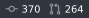

# multi-icon-badge

Renders several icon/value pairs as a **single** SVG badge, on demand.

```
https://multi-icon-badge.<subdomain>.workers.dev/?items=git-commit:370,git-pull-request:264
```



## Why this exists

shields.io supports exactly **one** logo per badge, and hard-codes custom SVG logos to a 14×14 box (`DEFAULT_LOGO_HEIGHT`; the aspect-preserving `logoSize=auto` path only runs for named simple-icons). The PR that would have lifted that, [badges/shields#11093](https://github.com/badges/shields/pull/11093), was closed unmerged.

So several icons mean several images, and a row of images is not one badge. They size independently, wrap independently, load and fail independently, and the gap between them belongs to whatever is rendering them rather than to you. One request returning one SVG gives you a single element to place, with the spacing settled where the badge is drawn.

That last point bites hardest wherever the host adds spacing you can't override. A GitHub README is one such place: its markdown CSS applies `padding-left: 20px` to every `img[align=right]`, and since only `` and `<table>` float via the `align` attribute, two right-aligned badges can never sit flush there.

## Routes

### `GET /` — the usage page

Opening the root with no query returns a short HTML page: three live examples, each rendered by the worker serving it. Any query at all means a badge was intended, so a malformed one still gets a 400 rather than the page.

### `GET /?items=…` — explicit values

| param | default | notes |
| --- | --- | --- |
| `items` | _required_ | comma-separated `icon:value` pairs, up to 6; value 1–12 chars |
| `color` | `2f363d` | pill background, 3- or 6-digit hex, no `#`, or `none` for no background |
| `iconColor` | `8B949E` |  |
| `textColor` | `fff` |  |
| `height` | `20` | 12–64; everything scales from it |
| `radius` | `0` | corner radius; `0` matches shields' flat-square |

`color=none` draws no background, so the badge sits on whatever is behind it. Nothing then separates the badge from the page, so `iconColor` and `textColor` have to carry their own contrast — a README shown on both GitHub themes wants a mid grey such as `6E7681` rather than the default white text, which disappears on a light background.

Values live in the URL, so a changed value is a different URL — the response is cached for a week and can never go stale.

### `GET /<provider>` — live values

A **provider** looks values up itself, for a fixed set of icons, so the URL holds no numbers — which is what keeps a generated README reproducible while the numbers stay current. Cached an hour; a lookup that fails renders `?` with a 5-minute cache rather than breaking the image. The style params above apply here too.

#### `github`

`GET /github?repo=owner/name` renders `git-commit` and `git-pull-request` with the repo's total commits and pull requests. Set a token to raise the rate limit (Cloudflare egress IPs are shared, so the unauthenticated 60/hour is easy to exhaust):

```sh
wrangler secret put GITHUB_TOKEN
```

Private repos aren't readable this way — pass their numbers to `/` instead.

### Icons

Any [octicon](https://primer.style/foundations/icons) slug works — all 408 of them, square or not.

Internals — why the icon registry and the width table are generated, the constraints the renderer works under, and the development commands — are in [docs/internals.md](./docs/internals.md).
